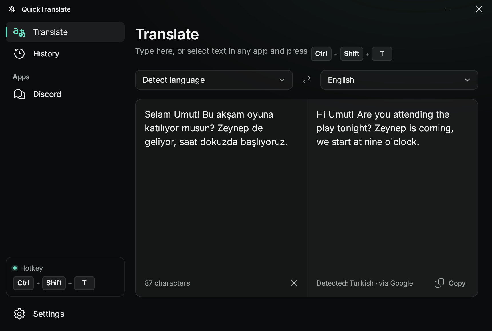
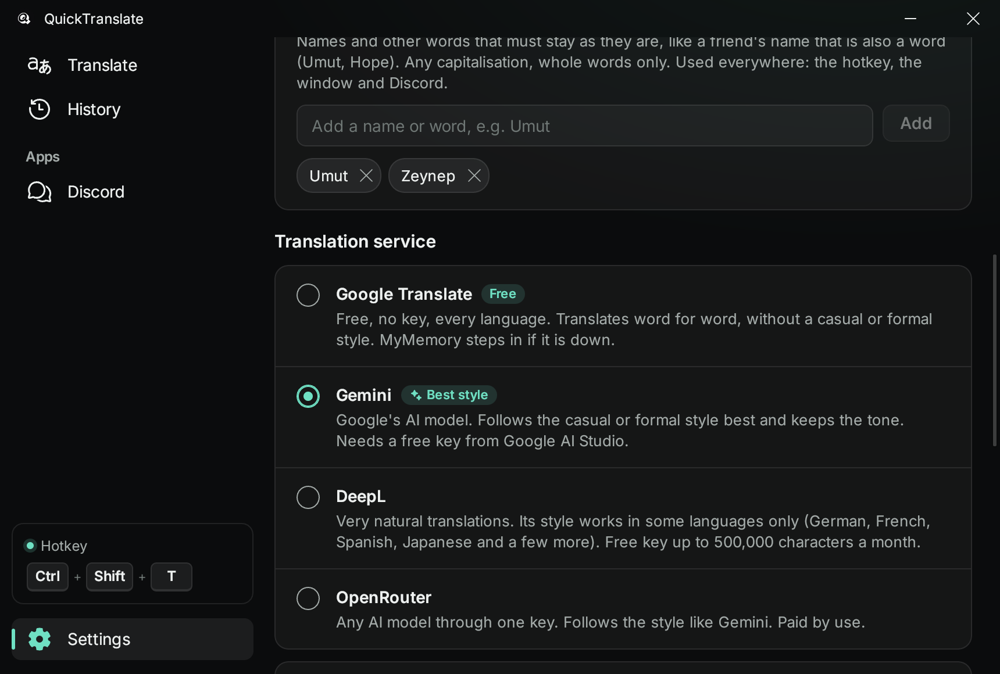
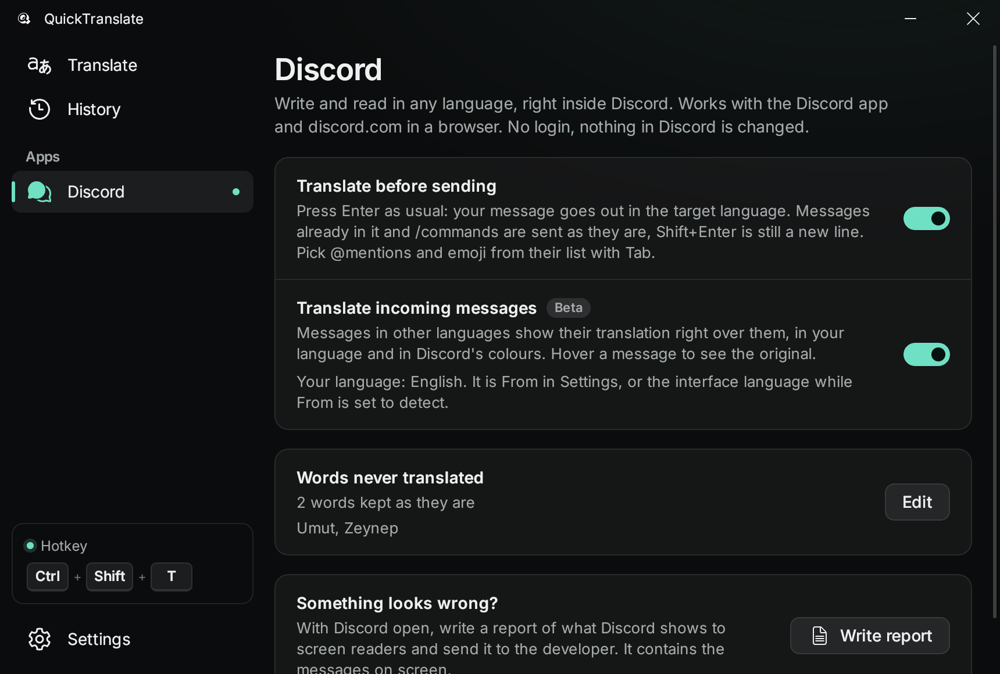

<div align="center">


# QuickTranslate

**Translate the text you are writing, in any app, with one hotkey.**

[](https://github.com/sleax-dev/quicktranslate/actions/workflows/build.yml)
[](https://github.com/sleax-dev/quicktranslate/releases/latest)

[](LICENSE)

[Download](https://github.com/sleax-dev/quicktranslate/releases/latest) · [Report a bug](https://github.com/sleax-dev/quicktranslate/issues)



</div>

Select text in any app, or just click into a text box, and press `Ctrl+Shift+T` (`⌃⇧T` on macOS). The translation replaces the text where it is. QuickTranslate waits in the tray and costs almost nothing until you need it.

## What it does

- **Works in every app.** Translates the selection, or the whole text box when nothing is selected, and puts the translation in its place.
- **Both directions with one hotkey.** Text already in the target language goes back into yours, so the same keys answer a message and translate the reply.
- **Casual or formal.** With Gemini (a free key), DeepL or OpenRouter, pick how the translation should sound: a message to a friend or an email to a client. The AI models are told how each language says "you" (*sen / siz*, *du / Sie*, *tu / vous* and so on).
- **Words never translated.** Add names like *Umut* or *Hope* once. They stay as written everywhere, in any capitalisation, and the suffixes around them stay too.
- **Discord.** Press Enter as usual and the message goes out translated, in the language you pick for Discord. Incoming messages in other languages show their translation right over them, in the language you read (beta, Windows). No login, nothing in Discord is changed.
- **Make it yours.** Pick an accent colour or any colour of your own, put a picture behind the window, blurred or sharp and darkened as much as you like, and let the accent follow the picture.
- **Free out of the box.** Google Translate needs no key; MyMemory steps in if it is down.
- **Light on your PC.** The window's WebView is closed when you close the window, the app runs in Windows efficiency mode while it waits, and the Discord keyboard hook exists only while that setting is on.
- **Updates itself** from signed releases. Ten interface languages, notifications included. No account, no telemetry.

<table>
  <tr>
    <td></td>
    <td></td>
  </tr>
</table>

## Install

Every [release](https://github.com/sleax-dev/quicktranslate/releases/latest) holds the installers for all three systems. After the first install, new versions arrive by themselves.

**Windows 10 / 11.** Run `QuickTranslate_<version>_x64-setup.exe`. It installs for your user, no administrator rights needed. The installer is not code-signed yet, so SmartScreen may warn: **More info → Run anyway**.

**macOS 10.15 or later** (Apple Silicon and Intel). Open `QuickTranslate_<version>_universal.dmg` and drag the app into Applications. The app is not notarized, so open it once, then **System Settings → Privacy & Security → Open Anyway**. To let it copy and paste for you: **Privacy & Security → Accessibility → QuickTranslate**, then restart it.

**Linux** (x86_64, Ubuntu 22.04 / Debian 12 / Fedora 36 or newer):

```sh
sudo apt install ./QuickTranslate_<version>_amd64.deb        # Ubuntu, Debian, Mint
sudo dnf install ./QuickTranslate-<version>-1.x86_64.rpm     # Fedora, openSUSE, RHEL
chmod +x QuickTranslate_*.AppImage && ./QuickTranslate_*.AppImage
```

The hotkey needs an X11 session: Wayland does not let apps register global hotkeys or type for you. On GNOME the tray icon needs the AppIndicator extension (preinstalled on Ubuntu).

## Translation services

| | Key | Casual / formal | Notes |
|---|---|---|---|
| **Google Translate** | none | no | The default. MyMemory takes over if Google is unreachable. |
| **Gemini** | free, [Google AI Studio](https://aistudio.google.com/apikey) | yes, best | Google's AI model; also reports the language it read. |
| **DeepL** | free up to 500,000 characters a month | some languages | German, French, Spanish, Japanese and a few more. |
| **OpenRouter** | paid by use | yes | Any AI model through one key. |

## Privacy

Text is sent only to the translation service you picked, only when you translate. History stays in memory and is gone when the app quits. Settings and keys are stored in `%APPDATA%\QuickTranslate`, `~/Library/Application Support/QuickTranslate` or `~/.config/QuickTranslate`. The app also contacts GitHub to check for updates.

The Discord features read what Discord shows to screen readers through Windows UI Automation and type with the keyboard like you do: no client mod, no token, no bot.

## Build from source

Requires Node.js LTS, stable Rust and the [Tauri prerequisites](https://v2.tauri.app/start/prerequisites/) (on Debian/Ubuntu: `libwebkit2gtk-4.1-dev libayatana-appindicator3-dev librsvg2-dev libxdo-dev libssl-dev`).

```sh
npm install
npm run tauri dev     # run with hot reload
npm run tauri build   # installers in src-tauri/target/release/bundle
```

Pushing a `v*` tag builds Windows, macOS and Linux on GitHub Actions and publishes them, signed for the updater, as one release.

## License

[MIT](LICENSE). The interface font is [Inter](https://rsms.me/inter/) (SIL OFL); the icons are [Fluent UI System Icons](https://github.com/microsoft/fluentui-system-icons) (MIT).
